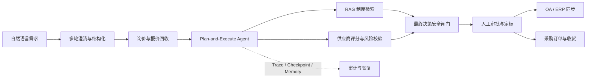

# Enterprise Procurement Intelligence Agent


面向制造企业采购场景的完整可运行 Agent 演示项目。即使不配置外部大模型 API，也能完成采购需求澄清、供应商筛选、风险识别、报价比较、审批判断、订单履约与全链路审计。

> 仓库中的公司、员工、供应商、报价和采购记录均为虚构的演示数据，不代表真实企业或交易。

## 系统流程



## 已实现

- 模拟企业、员工、供应商、历史采购、报价和采购申请数据
- 基于采购制度的确定性规则引擎
- 供应商多维评分与推荐理由
- 采购申请分析工作流
- FastAPI 查询接口
- 本地制度知识库 BM25 + 稠密向量混合检索与可追溯引用
- LangGraph 多节点采购 Agent 与完整决策轨迹
- Agent `plan → tool → observe → re-plan → validate → finalize` 动态执行循环
- Agent 工具输入/输出 Pydantic 契约、未知参数拒绝与异常结果隔离
- 工具故障分类与选择性重试：瞬时连接故障重试，确定性错误快速失败
- 可配置的 Agent 最大轮次与整次运行时间预算，超限后保留失败 checkpoint
- 持久化协作式取消信号、取消审计、检查点状态与终态 Trace
- Trace SHA-256 哈希链、独立链头与历史事件完整性校验接口
- 工具输入/输出、事实快照与最终采购结论的稳定决策指纹
- 从持久化工具 Trace 重放来源证据清单，联合验证来源、结论和 Trace 完整性
- 版本化采购规则清单、规则指纹与历史决策版本漂移检测
- 独立最终决策安全闸门，跨工具复核供应商、报价、审批、路由和制度证据
- 不可信上下文边界与 Prompt Injection 检测，风险上下文自动切换本地确定性 Planner
- 模型 Planner 结构校验、本地安全降级及逐次降级 Trace
- 基于持久化 Trace 的 Agent 成功率、工具失败率、恢复与 Planner 降级指标
- Trace 与长期记忆的数据保留预览、失败现场保护和显式清理工具
- 自然语言采购需求结构化解析
- SQLite 运行快照、待审批队列与人工审批记录
- 自然语言需求正式提交、动态采购申请与批量询价单
- 供应商报价回收、自动比价与报价防重复
- 审批权限校验、申请审批职责分离和操作审计
- 可持久化的多轮采购需求澄清与会话恢复
- 可替换的 OA/ERP 集成端口、本地/HTTP 适配器与幂等同步记录
- SQLite 异步集成任务队列、原子领取、指数退避和失败终止
- 供应商询价 Outbox、独立发送 Worker、HMAC 回调验签和防重放
- 供应商定标、采购订单状态机、收货记录和管理统计
- 可插拔语言理解层：本地规则默认运行，可选 OpenAI Structured Outputs
- LangGraph 条件路由、独立只读 Tools 层和版本化 Prompt
- LangGraph SQLite checkpoint、原生 interrupt/resume 与内部长期决策记忆
- 本地安全工具编排器：白名单调用申请、供应商和制度检索工具并记录调用轨迹
- Agent/RAG 基准评测集、逐项检查结果和通过率报告
- Bearer 身份认证、角色化工具权限和调用人审计
- 命令行演示与自动化测试
- React + TypeScript 采购管理控制台，覆盖多轮需求澄清、询价与报价、Agent 执行恢复、审批定标、OA/ERP 集成、订单收货与审计

## 快速开始

要求 Python 3.11+。

```powershell
python -m venv .venv
.venv\Scripts\Activate.ps1
pip install -e ".[dev]"
python -m procurement_agent.interfaces.cli PR001
python -m procurement_agent.evaluation.runner
uvicorn procurement_agent.main:app --reload --env-file .env
```

### 启动管理控制台

开发模式下同时启动 FastAPI 和 Vite，前端会把 `/api` 请求代理到
`127.0.0.1:8000`：

```powershell
# 终端 1
.venv\Scripts\python -m uvicorn procurement_agent.main:app --reload

# 终端 2
cd frontend
npm install
npm run dev
```

浏览器打开 `http://127.0.0.1:5173/app/`。执行 `npm run build` 后，FastAPI
会在 `http://127.0.0.1:8000/app/` 直接托管构建结果；Docker 镜像会自动完成前端构建。

数据保留维护默认只输出预览，不会删除数据：

```powershell
procurement-agent-maintenance --trace-days 90 --memory-days 365
procurement-agent-maintenance --trace-days 90 --memory-days 365 --delete
```

默认保留失败运行的完整 Trace 和人工审批记忆。只有明确提供
`--delete-failed-traces` 或 `--delete-approval-memories` 才会将它们纳入清理范围。

受保护的工具 Agent 接口需要先在 `.env` 中启用认证：

```dotenv
AUTH_ENABLED=true
AUTH_TOKENS=请替换为长随机令牌|E001|PROCUREMENT
```

随后使用 `Authorization: Bearer <令牌>` 调用 `POST /api/v1/agent/assist`。
当 `AUTH_ENABLED=true` 时，认证中间件会保护全部 `/api/v1` 业务接口；生产环境的就绪检查也会拒绝未启用或未配置认证的实例。

API 启动后访问 `http://127.0.0.1:8000/docs`。

管理控制台：`http://127.0.0.1:8000/app/`。

完整业务冒烟测试：

```powershell
.venv\Scripts\python scripts\smoke_test.py
```

可选启用大模型需求抽取：

```powershell
pip install -e ".[llm]"
$env:LLM_PROVIDER="openai"
$env:OPENAI_API_KEY="你的 API Key"
uvicorn procurement_agent.main:app --reload
```

未设置 API Key 或未安装可选依赖时，系统自动使用本地规则抽取，不影响采购主流程。

Agent 默认最多执行 10 个工具轮次，整次分析时间预算为 30 秒，可通过
`AGENT_MAX_ITERATIONS` 和 `AGENT_MAX_RUNTIME_SECONDS` 调整。时间预算在故障恢复时重新计算，历史已完成步骤不会重复执行。

运行中的持久化执行可由采购人员或经理调用
`POST /api/v1/agent/runs/{execution_id}/cancel` 请求取消。Agent 会在安全节点边界停止；取消是终态，后续分析应使用新的 `execution_id`。

每条 Agent Trace 都包含 `previous_hash` 和 `event_hash`。使用
`GET /api/v1/agent/runs/{run_id}/trace/verify` 可以校验完整事件链、链头和事件数量，并定位首条被修改或断链的事件。

每次成功分析的 `provenance` 包含 Prompt 版本、Planner 来源、工具契约版本、`source_fingerprint` 和 `decision_fingerprint`。工具调用同时保存参数与输出哈希，便于判断结论变化来自业务数据、规则版本还是模型配置变化。

确定性审批阈值、询价数量、供应商准入和评分权重统一定义在版本化规则清单中。使用 `GET /api/v1/agent/runs/{run_id}/provenance/verify` 可验证历史决策指纹，并判断其 Prompt、工具契约和采购规则是否仍与当前版本一致。

Docker 启动：

```powershell
docker compose up --build
```

Docker 生产启动要求先在 `.env` 中设置 `AUTH_TOKENS`。Web 服务和独立 `integration-worker` 共享持久化任务队列。
镜像内已设置 `PROJECT_ROOT=/app`，保证普通 Python 安装后仍能定位企业数据、评估集和前端静态资源；非可编辑 wheel 安装也应显式设置该变量。

OA/ERP 默认使用 `INTEGRATION_MODE=mock`。切换真实 HTTP 网关时设置：

```dotenv
INTEGRATION_MODE=http
OA_BASE_URL=https://oa.example.internal
OA_API_TOKEN=请从密钥管理系统注入
ERP_BASE_URL=https://erp.example.internal
ERP_API_TOKEN=请从密钥管理系统注入
```

创建异步任务：`POST /api/v1/integrations/jobs?run_id=<RUN_ID>&target=OA`。单独运行 Worker：

```powershell
procurement-integration-worker
```

供应商询价默认使用本地模拟网关。真实发送和报价回调配置：

```dotenv
SUPPLIER_DELIVERY_MODE=http
SUPPLIER_GATEWAY_URL=https://supplier-gateway.example.internal
SUPPLIER_GATEWAY_TOKEN=请从密钥管理系统注入
SUPPLIER_CALLBACK_SECRET=请设置长随机回调验签密钥
```

使用 `procurement-rfq-worker` 运行发送 Worker。供应商回调必须提供 `X-Event-ID`、`X-Timestamp` 和 `X-Signature`，签名内容为 `<timestamp>.<原始请求体>` 的 HMAC-SHA256。

运行状态接口：`/health/live`、`/health/ready`、`/metrics`。每个响应都会带有 `X-Request-ID` 和处理耗时响应头，服务日志以 JSON 输出。

主要接口：

- `GET /api/v1/requests`：查看采购申请
- `GET /api/v1/requests/PR001/analysis`：运行采购决策工作流
- `GET /api/v1/knowledge/search?query=超过十万元需要几家报价`：检索制度依据
- `GET /api/v1/knowledge/status`：查看知识库文档和分块数量
- `GET /api/v1/agent/steps`：查看 Agent 节点顺序
- `GET /api/v1/agent/capabilities`：查看 Agent 工具、Prompt 版本和路由能力
- `POST /api/v1/agent/sessions?request_id=PR001`：启动带 SQLite checkpoint 的 Agent 会话；需要人工确认时自动中断
- `GET /api/v1/agent/sessions/{thread_id}`：读取持久化会话及待处理动作
- `POST /api/v1/agent/sessions/{thread_id}/resume`：提交审批决定并从中断节点继续执行
- `POST /api/v1/intake/parse`：解析自然语言采购需求
- `POST /api/v1/intake/submit`：解析并创建正式采购申请
- `POST /api/v1/requests/{request_id}/rfqs`：为合格供应商批量创建询价单
- `GET /api/v1/requests/{request_id}/rfqs`：查看询价单
- `POST /api/v1/rfqs/{rfq_id}/quotation`：供应商提交报价
- `GET /api/v1/requests/{request_id}/quotations`：查看申请的全部报价
- `GET /api/v1/audit/events`：查看操作审计事件
- `POST /api/v1/conversations`：开始多轮采购需求澄清
- `POST /api/v1/conversations/{session_id}/messages`：逐步补充需求
- `POST /api/v1/conversations/{session_id}/submit`：生成正式采购申请
- `POST /api/v1/integrations/runs/{run_id}/oa`：提交 OA 审批
- `POST /api/v1/integrations/runs/{run_id}/erp`：将已批准结果同步为 ERP 草稿
- `POST /api/v1/integrations/jobs`：幂等创建 OA/ERP 异步任务
- `GET /api/v1/integrations/jobs/{job_id}`：查询任务、重试次数和失败原因
- `POST /api/v1/requests/{request_id}/rfq-deliveries`：幂等创建供应商询价发送任务
- `GET /api/v1/requests/{request_id}/rfq-deliveries`：查看发送状态与失败原因
- `POST /api/v1/supplier-callbacks/quotations/{rfq_id}`：接收验签后的供应商报价
- `POST /api/v1/orders`：对已批准的推荐供应商执行定标
- `POST /api/v1/orders/{po_id}/status`：推进订单状态
- `POST /api/v1/orders/{po_id}/receipts`：登记到货验收
- `GET /api/v1/dashboard/summary`：查看采购运行统计
- `POST /api/v1/agent/runs?request_id=PR001&execution_id=EXEC-001`：使用稳定执行 ID 运行并保存 Agent；失败时返回可恢复的执行 ID
- `GET /api/v1/agent/runs`：查询可恢复的历史运行
- `GET /api/v1/agent/runs/{run_id}/trace`：查询脱敏后的 Agent 执行事件时间线
- `GET /api/v1/agent/runs/{execution_id}/execution`：查看 checkpoint 中的执行计划、失败步骤和重试次数
- `POST /api/v1/agent/runs/{execution_id}/retry`：故障排除后从失败步骤恢复执行
- `POST /api/v1/agent/runs/{run_id}/approval`：批准或驳回运行

## 目录

```text
Purchase/
├─ .github/workflows/       GitHub Actions 持续集成
├─ data/raw/company/       模拟结构化业务数据
├─ data/raw/documents/     企业采购制度知识库
├─ docs/                   架构与路线图
├─ evals/                  Agent 与 RAG 基准用例
├─ frontend/               React + TypeScript 管理控制台
├─ src/procurement_agent/
│  ├─ domain/              领域模型与采购规则
│  ├─ application/         业务用例与工作流
│  ├─ agents/              LangGraph Agent、Tools 与持久化人工审批图
│  ├─ prompts/             带版本元数据的 Agent Prompt
│  ├─ infrastructure/      数据库、仓储与知识库
│  ├─ api/routers/         分类后的 HTTP API
│  ├─ interfaces/          命令行入口
│  ├─ core/                项目配置
│  └─ main.py              ASGI 启动入口
└─ tests/                  自动化测试
```

## 发布前验证

```powershell
# 后端测试与 Agent/RAG 评估
.venv\Scripts\python -m pytest
.venv\Scripts\python -m procurement_agent.evaluation.runner

# 前端类型检查与生产构建
cd frontend
npm ci
npm run typecheck
npm run build
```

当前基线：后端测试 76 项通过，Agent/RAG 评估 6/6 通过。Docker 配置已提供，但仍应在安装 Docker 的环境中执行一次真实镜像构建后再发布容器制品。

## 设计原则

采购金额、风险门槛和审批等级由可审计规则决定；未来接入 LLM 时，模型用于理解自然语言、检索制度和生成解释，不直接绕过业务约束。

## 开源协作与安全

- 贡献流程见 [CONTRIBUTING.md](CONTRIBUTING.md)。
- 安全问题请按照 [SECURITY.md](SECURITY.md) 私下报告，不要在公开 Issue 中提交密钥或真实采购数据。
- 本项目采用 [MIT License](LICENSE)。

